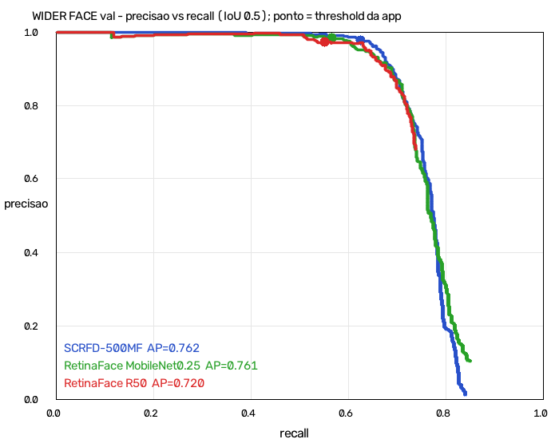
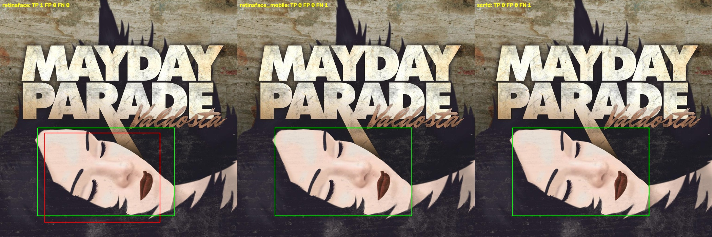
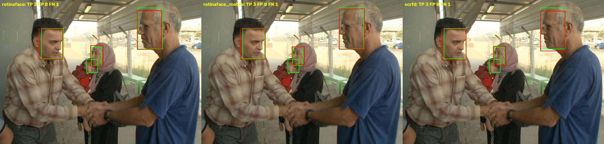
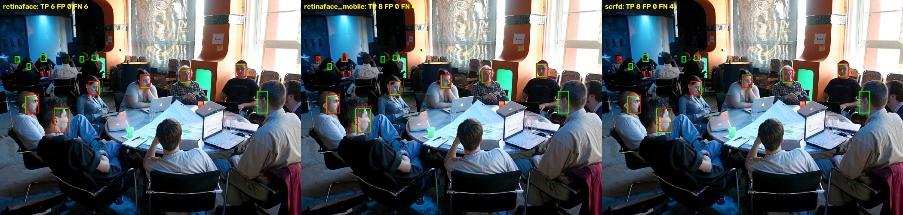
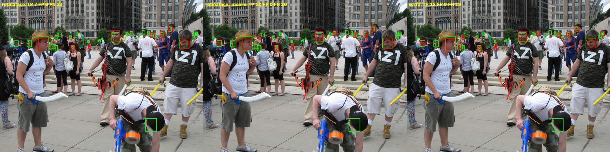
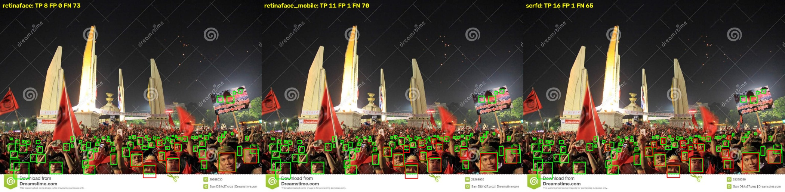

# Parte 1 — Comparação de detetores de caras

**Objetivo (enunciado, secção 4.1):** comparar detetores de caras em **exatidão**, **tempo de inferência** e
**robustez** a caras pequenas, pose, oclusão parcial e várias caras na mesma imagem.

---

## 1. Configuração experimental

### 1.1 Modelos comparados

| Modelo | Implementação | Entrada | Threshold (app) | NMS | Licença |
|---|---|---|---|---|---|
| **SCRFD-500MF** | InsightFace, ONNX (`det_500m.onnx`) | letterbox 640×640 | 0.5 | 0.4 (interno) | InsightFace — investigação não comercial |
| **RetinaFace MobileNet0.25** | yakhyo/retinaface-pytorch, ONNX (`retinaface_mv1_0.25.onnx`) | resolução original | 0.9 | 0.4 | MIT |
| **RetinaFace ResNet50** | serengil/retinaface (TensorFlow) | imagem reduzida a 50% (`scale 0.5`) | 0.9 | interno | MIT (pesos InsightFace) |

Os três devolvem a mesma estrutura: caixa, score e 5 landmarks (olhos, nariz, cantos da boca).

### 1.2 Dados
- **WIDER FACE — partição de validação**, comparada com o ground truth oficial (`wider_face_val_bbx_gt.txt`).
- Amostra de **100 imagens aleatórias** (seed 0) com **563 caras válidas**. As caras marcadas `invalid`
  no GT são ignoradas: uma deteção sobre elas não conta como TP nem como FP.
- Para a inspeção visual e para os tempos detalhados usaram-se ainda **5 imagens** de cenários diferentes,
  com 1, 4, 12, 30 e 81 caras.

### 1.3 Métricas
- **Matching:** uma deteção é verdadeiro positivo (TP) se tiver **IoU ≥ 0.5** com uma cara GT. Cada cara GT
  só pode ser associada a uma deteção, percorrendo as deteções por ordem decrescente de score.
- **Curva precisão–recall:** obtida correndo cada detetor com threshold baixo (0.02) e variando o threshold.
- **AP (Average Precision):** área sob a curva precisão–recall (AUC-PR), com interpolação *all-points*
  (estilo PASCAL VOC). É a métrica principal porque **não depende do threshold** escolhido.
- **Precisão e recall no threshold da aplicação:** o comportamento real de cada modelo como está configurado.
- **Robustez:** recall calculado separadamente para cada condição anotada no GT do WIDER (tamanho, pose,
  oclusão, blur, iluminação, expressão) e por número de caras na imagem.
- **Tempo:** só a chamada `detect()`, com pré e pós-processamento incluídos. A primeira chamada (aquecimento)
  não é contada.

### 1.4 Hardware
Apple M1, **só CPU** (onnxruntime `CPUExecutionProvider` / TensorFlow CPU). O Python do ambiente é x86_64 e
corre através do Rosetta, por isso os valores absolutos são mais lentos do que seriam com Python nativo
arm64. A comparação entre modelos mantém-se válida, porque estão todos nas mesmas condições.

---

## 2. Exatidão

### 2.1 Resultados globais (100 imagens, 563 caras)

| Métrica | SCRFD-500MF | RetinaFace MobileNet0.25 | RetinaFace R50 |
|---|---|---|---|
| **AP / AUC-PR** (IoU 0.5) | **0.762** | 0.761 | 0.720 |
| Precisão @ threshold da app | 0.978 | **0.985** | 0.972 |
| Recall @ threshold da app | **0.625** | 0.567 | 0.552 |

*Curva precisão–recall dos três detetores. O ponto em cada curva marca o threshold usado na aplicação.*

**Leitura:**
- O SCRFD e o RetinaFace MobileNet têm AP praticamente igual (0.762 vs 0.761). O RetinaFace R50 fica atrás
  (0.720), sobretudo porque corre com a imagem reduzida a metade.
- A precisão é muito alta nos três (≥ 0.97): quando um detetor diz que há uma cara, quase sempre há.
  As diferenças estão no **recall**, ou seja, nas caras que cada modelo não encontra.
- As curvas ficam todas abaixo de recall ≈ 0.85. Há caras no WIDER que nenhum dos três encontra, mesmo com
  threshold muito baixo (sobretudo caras com menos de 16 px; ver secção 4).
- Os thresholds da aplicação são diferentes (0.5 no SCRFD, 0.9 nos RetinaFace), por isso a precisão e o recall
  nesse ponto **não são uma comparação justa entre modelos**. A AP é.

### 2.2 Inspeção visual (5 imagens)

| Imagem | Caras GT | RetinaFace R50 (TP / FN) | RetinaFace MobileNet (TP / FN) | SCRFD (TP / FN) |
|---|---|---|---|---|
| Parade (cartaz desenhado) | 1 | **1 / 0** | 0 / 1 | 0 / 1 |
| Handshaking | 4 | 3 / 1 | 3 / 1 | 3 / 1 |
| Meeting | 12 | 6 / 6 | **8 / 4** | **8 / 4** |
| Group | 30 | 7 / 23 | 10 / 20 | **12 / 18** |
| Demonstration | 81 | 8 / 73 | 11 / 70 | **16 / 65** |
| **Total** | **128** | **25 / 103** (P 1.00, R 0.20) | **32 / 96** (P 0.97, R 0.25) | **39 / 89** (P 0.97, R 0.30) |

Nas imagens, verde = ground truth e vermelho = deteção. Ordem dos painéis: RetinaFace R50 | RetinaFace MobileNet | SCRFD.

---

## 3. Tempo de inferência

### 3.1 Nas 100 imagens do WIDER (1 passagem por imagem)

| | SCRFD-500MF | RetinaFace MobileNet0.25 | RetinaFace R50 |
|---|---|---|---|
| ms/imagem (média) | **29.4** | 62.3 | 395.0 |
| ms/imagem (p95) | **53.5** | 127.2 | 718.4 |
| FPS | **34.0** | 16.1 | 2.5 |

### 3.2 Medição controlada (5 imagens × 20 repetições)

| Modelo | Configuração | ms/imagem (média ± dp) | Mediana (ms) | FPS | Relativo ao SCRFD |
|---|---|---|---|---|---|
| **SCRFD-500MF** | 640×640, thr 0.5 | **32.2 ± 15.4** | **21.5** | **31.1** | 1.0× |
| RetinaFace MobileNet0.25 | resolução original, thr 0.9 | 48.8 ± 13.2 | 38.6 | 20.5 | 1.5× |
| RetinaFace R50 | scale 0.5, thr 0.9 | 399.2 ± 75.2 | 354.8 | 2.5 | 12.4× |
| RetinaFace R50 | scale 1.0, thr 0.9 *(referência, não usado na app)* | 1646.4 ± 221.5 | 1448.1 | 0.6 | 51.1× |

| Modelo | Parade (1 cara, 1024×1024) | Handshaking (4, 1024×736) | Meeting (12, 1024×732) | Group (30, 1024×768) | Demonstration (81, 1024×754) |
|---|---|---|---|---|---|
| SCRFD-500MF | 48.1 ± 16.9 | 32.7 ± 16.1 | 22.7 ± 7.6 | 25.5 ± 12.4 | 32.0 ± 20.7 |
| RetinaFace MobileNet0.25 | 53.8 ± 5.3 | 38.0 ± 3.2 | 38.3 ± 3.6 | 49.2 ± 15.1 | 64.9 ± 24.4 |
| RetinaFace R50 (scale 0.5) | 470.9 ± 28.3 | 432.1 ± 113.6 | 374.5 ± 97.4 | 339.5 ± 17.5 | 379.2 ± 69.0 |
| RetinaFace R50 (scale 1.0) | 2150.5 ± 236.4 | 1552.4 ± 278.5 | 1446.4 ± 150.7 | 1596.4 ± 276.7 | 1486.2 ± 112.2 |

**Leitura:**
- O SCRFD e o RetinaFace MobileNet servem para tempo real em CPU (> 15 FPS). O RetinaFace R50 não serve:
  fica a 2.5 FPS mesmo a meia resolução.
- O tempo depende sobretudo da **resolução da imagem**, não do número de caras. A imagem com 81 caras não é
  mais lenta do que a de 4, porque o pós-processamento (descodificar as caixas e NMS) é barato.
- O SCRFD tem um tempo quase constante porque redimensiona sempre a entrada para 640×640. O RetinaFace
  MobileNet processa a imagem na resolução original, por isso o tempo cresce com o tamanho da imagem.

---

## 4. Robustez (recall no threshold da aplicação, 100 imagens)

A coluna "caras" indica quantas caras do GT há em cada condição.

### 4.1 Caras pequenas — tamanho = √(largura × altura) em píxeis

| Tamanho | Caras | SCRFD-500MF | RetinaFace MobileNet0.25 | RetinaFace R50 |
|---|---|---|---|---|
| < 16 px | 85 | **0.024** | 0.000 | 0.000 |
| 16–32 px | 140 | **0.557** | 0.414 | 0.350 |
| 32–64 px | 203 | **0.754** | 0.700 | 0.704 |
| 64–128 px | 89 | 0.854 | 0.843 | **0.876** |
| ≥ 128 px | 46 | 0.935 | **0.957** | 0.891 |

### 4.2 Pose

| Pose | Caras | SCRFD-500MF | RetinaFace MobileNet0.25 | RetinaFace R50 |
|---|---|---|---|---|
| típica | 501 | **0.661** | 0.601 | 0.587 |
| atípica | 62 | **0.339** | 0.290 | 0.274 |

### 4.3 Oclusão parcial

| Oclusão | Caras | SCRFD-500MF | RetinaFace MobileNet0.25 | RetinaFace R50 |
|---|---|---|---|---|
| nenhuma | 387 | **0.762** | 0.724 | 0.693 |
| parcial | 76 | **0.434** | 0.329 | 0.329 |
| forte | 100 | **0.240** | 0.140 | 0.180 |

### 4.4 Várias caras na mesma imagem (recall / precisão)

| Caras por imagem | Imagens | SCRFD-500MF | RetinaFace MobileNet0.25 | RetinaFace R50 |
|---|---|---|---|---|
| 1 | 33 | 0.909 / 1.000 | 0.909 / 1.000 | 0.909 / 1.000 |
| 2–5 | 31 | **0.783** / 0.935 | 0.750 / 0.958 | 0.750 / 0.986 |
| 6–20 | 33 | **0.584** / 0.986 | 0.531 / 0.990 | 0.520 / 0.974 |
| > 20 | 3 | **0.512** / 1.000 | 0.378 / 1.000 | 0.329 / 0.900 |

### 4.5 Outras condições anotadas no WIDER

| Condição | Valor | Caras | SCRFD-500MF | RetinaFace MobileNet0.25 | RetinaFace R50 |
|---|---|---|---|---|---|
| Blur | nítida | 197 | **0.914** | 0.888 | 0.878 |
| Blur | normal | 202 | **0.683** | 0.619 | 0.589 |
| Blur | forte | 164 | **0.207** | 0.116 | 0.116 |
| Iluminação | normal | 526 | **0.612** | 0.557 | 0.538 |
| Iluminação | extrema | 37 | **0.811** | 0.703 | 0.757 |
| Expressão | típica | 556 | **0.621** | 0.563 | 0.549 |
| Expressão | exagerada | 7 | **1.000** | 0.857 | 0.857 |

**Leitura:**
- **Caras pequenas** são o principal ponto fraco dos três. Abaixo de 16 px o recall é praticamente zero, e entre
  16 e 32 px o SCRFD encontra 56% das caras contra 35–41% dos RetinaFace. A redução a 50% do RetinaFace R50
  explica o seu pior resultado neste intervalo.
- **Pose atípica** e **oclusão** reduzem o recall para cerca de metade em todos os modelos. O SCRFD é o mais robusto.
- **Várias caras:** com uma cara por imagem os três são iguais (0.91). À medida que aumenta o número de caras,
  o recall desce, porque em imagens com muitas caras estas tendem a ser pequenas, desfocadas e ocluídas. Essa
  descida é menor no SCRFD.
- A precisão mantém-se alta em todas as condições: os modelos falham por **não detetar** caras, quase nunca
  por detetar caras que não existem.
- Os valores da iluminação extrema (37 caras) e da expressão exagerada (7 caras) assentam em poucas amostras
  e não devem ser interpretados como uma vantagem real.

---

## 5. Conclusão

| Critério | Melhor modelo |
|---|---|
| Exatidão (AP) | SCRFD ≈ RetinaFace MobileNet (0.762 / 0.761) |
| Tempo | **SCRFD** (~30 ms, ~31–34 FPS) |
| Caras pequenas | **SCRFD** |
| Pose atípica | **SCRFD** |
| Oclusão parcial | **SCRFD** |
| Várias caras | **SCRFD** |

O **SCRFD-500MF** é o detetor escolhido para a aplicação em tempo real. Tem a AP mais alta, o melhor recall em
todas as condições difíceis e é o mais rápido. O RetinaFace MobileNet é uma alternativa viável, com exatidão
semelhante mas cerca de metade da velocidade. O RetinaFace ResNet50 não é adequado para tempo real em CPU.

---

## 6. Limitações desta avaliação
- **Amostra pequena (100 imagens).** Alguns grupos têm poucas amostras: só 3 imagens com mais de 20 caras e
  7 caras com expressão exagerada. Para os resultados finais deve usar-se uma amostra maior ou a validação completa.
- **Thresholds diferentes entre modelos** (0.5 vs 0.9). A precisão, o recall e a robustez calculados no
  threshold da aplicação refletem a configuração usada, não só a capacidade do modelo. Uma comparação com a
  mesma precisão para todos seria mais justa.
- **O RetinaFace R50 foi avaliado a 50% da resolução**, a configuração usada no projeto. À resolução original
  deteta mais caras pequenas, mas fica a ~1.6 s por imagem.
- **Não se usou o protocolo oficial easy/medium/hard do WIDER**, por isso os valores de AP não são diretamente
  comparáveis com os dos papers.
- **Só CPU, com Python x86_64 através do Rosetta.** Os tempos absolutos seriam melhores com Python nativo
  arm64 ou com GPU.

---

*Reproduzir:* `python eval_wider.py --max-images 100` (exatidão, robustez e curva P-R) a partir da pasta do projeto,
com o WIDER em `data/WIDER/`.
