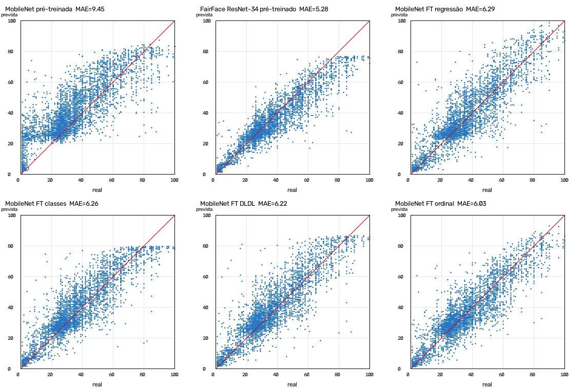
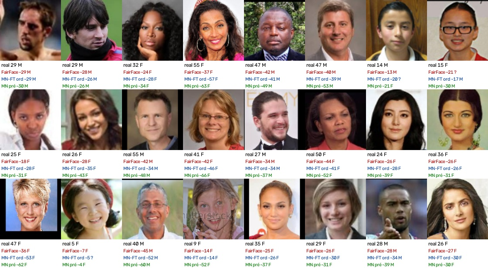
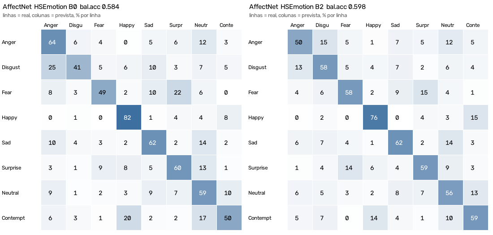
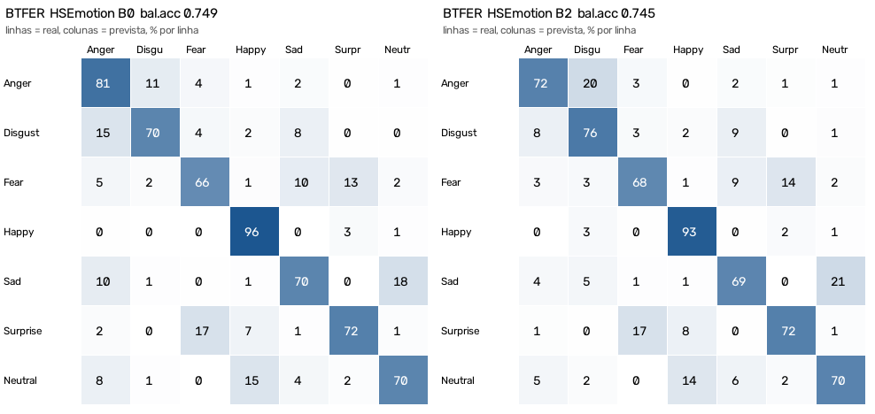

# Assignment #3 — Real-Time Facial Analysis: o que está feito e análise dos resultados

> **Atualização:** depois das fases 1–4 foi feito um **modelo final multitarefa** (backbone ArcFace + um ramo por tarefa), melhor em idade/género e mais rápido. Ver [GUIA_RESULTADOS.md](GUIA_RESULTADOS.md); este ficheiro fica como histórico das fases 1–4.

*Estado em 23/11/2026. Entrega: 29/11/2026.*

## Índice
1. [Visão geral do sistema](#1-visão-geral-do-sistema)
2. [Modelos utilizados](#2-modelos-utilizados)
3. [Fase 1 — Deteção de caras](#3-fase-1--deteção-de-caras)
4. [Fase 2 — Alinhamento](#4-fase-2--alinhamento)
5. [Fase 3 — Idade aparente e género](#5-fase-3--idade-aparente-e-género)
   - 5.1 Enquadramento · 5.2 Dados · 5.3 Modelos e formulações · 5.4 Ficheiros · 5.5 Treino ·
     5.6 Resultados · 5.7 Limitações e ética
6. [Fase 4 — Expressão facial](#6-fase-4--expressão-facial)
   - 6.1 Enquadramento · 6.2 Dados · 6.3 Modelos · 6.4 Avaliação · 6.5 Resultados · 6.6 Limitações ·
     6.7 Critérios do enunciado
7. [Análise global e melhores combinações](#7-análise-global-e-melhores-combinações)
   - 7.1 Resumo · 7.2 Conclusões transversais · 7.3 Custo das combinações · 7.4 Melhor combinação · 7.5 Enunciado
8. [Como correr tudo](#8-como-correr-tudo)
9. [O que falta](#9-o-que-falta)

---

## 1. Visão geral do sistema

O trabalho **integra modelos pré-treinados** numa aplicação em tempo real e **avalia-os**. Não se treinam
redes de raiz. Na Fase 3 há também **fine-tuning** de um modelo pré-treinado. Cada frame passa por:

```
frame ──► DETEÇÃO ──► caixa + 5 landmarks ──┬──► ALINHAMENTO (112×112) ──► identidade ArcFace   [Fase 5]
          SCRFD-500MF                        │                          └─► expressão HSEmotion [Fase 4 ✅]
                                             └──► IDADE + GÉNERO (dois modelos à escolha)       [Fase 3 ✅]
                                                    • crop 96×96 da caixa ──► MobileNet fine-tuned
                                                    • crop 224×224 alinhado ► FairFace ResNet-34 pré-treinado
```

| Fase | Estado | Onde |
|---|---|---|
| 1 — Aquisição + deteção | ✅ feita (falta a avaliação na validação completa do WIDER) | `main.py`, `deteccao/face_detector.py`, `deteccao/eval_wider.py` |
| 2 — Alinhamento | ✅ feita | `deteccao/face_alignment.py` |
| 3 — Idade + género | ✅ feita (falta o teste qualitativo na webcam) | `idade_genero/` |
| 4 — Expressão | ✅ feita, só com modelos pré-treinados (falta o teste na webcam) | `expressao/` |
| 5 — Identidade ArcFace | ⏳ por fazer | — |
| 6 — App integrada + tempo real | 🟡 parcial (deteção + idade/género + expressão, com escolha de modelos e benchmark; falta identidade e interface) | `main.py` |

A aplicação ([main.py](../main.py)) corre o detetor numa **thread à parte** (`AsyncDetector`). O vídeo mostra
sempre o frame mais recente com as últimas caras conhecidas, e a deteção, a idade/género e a expressão vão atualizando
ao ritmo que conseguirem, sem bloquear a imagem. Os modelos escolhem-se ao arrancar (menu, `--combo` ou opções) e
podem ser trocados com a app a correr (teclas `g`, `e`, `c`).

---

## 2. Modelos utilizados

| Modelo | Arquitetura | Tarefa | Ficheiro | Usado em |
|---|---|---|---|---|
| **SCRFD-500MF** (InsightFace) | detetor SCRFD, 500 MFLOPs | **encontrar** caras: caixa + 5 landmarks | `models/det_500m.onnx` | app (por omissão), Fases 1–3 |
| RetinaFace MobileNet0.25 | detetor RetinaFace, backbone MobileNet | deteção (comparação) | `models/retinaface_mv1_0.25.onnx` | Fase 1 |
| RetinaFace ResNet50 (serengil) | detetor RetinaFace, backbone ResNet50 | deteção (comparação) | biblioteca `retina-face` | Fase 1 |
| ArcFace MobileFaceNet (InsightFace) | MobileFaceNet, descritor de 512-D | descritor de identidade | `models/w600k_mbf.onnx` | Fase 2 (teste), Fase 5 |
| **genderage** (InsightFace) | **MobileNet-v1** multi-tarefa, entrada 96×96 | **estimar** idade + género (original) | `models/genderage.onnx` | Fase 3 (baseline) |
| **genderage fine-tuned** | a mesma MobileNet, ajustada no UTKFace | idade + género | `models/genderage_ft_{reg,cls,dldl,ordinal}.onnx` | Fase 3; na app: `mobilenet_ft` (= `ordinal`) |
| **FairFace** (Kärkkäinen & Joo, WACV 2021) | **ResNet-34**, entrada 224×224 alinhada | idade (9 faixas) + género, **só pré-treinado** | `models/fairface_res34.onnx` (85 MB) | Fase 3; na app: `fairface` (por omissão) |
| **HSEmotion B0 / B2** (Savchenko) | EfficientNet-B0 (224) / B2 (260) | expressão facial, **só pré-treinados** no AffectNet | `models/expr_hsemotion_{b0,b2}.onnx` | Fase 4; na app: `b2` por omissão |

> **Atenção à confusão comum:** o SCRFD **não** estima idade nem género. Só encontra a cara. A idade e o
> género vêm do **genderage** (MobileNet) ou do **FairFace** (ResNet-34), que recebem o crop da cara que o
> SCRFD encontrou.
> A "RetinaFace MobileNet0.25" também tem uma MobileNet, mas é um detetor e não é usada na Fase 3.

---

## 3. Fase 1 — Deteção de caras

*Relatório completo, com figuras: [deteccao/resultados/parte1_comparacao_detetores.md](../deteccao/resultados/parte1_comparacao_detetores.md)*

### O que foi feito
- [face_detector.py](../deteccao/face_detector.py) junta os 3 detetores atrás de uma **interface comum**:
  `detect(frame)` devolve sempre `[{score, box, landmarks(5)}]`. Isto permite trocar de detetor sem mexer no
  resto do código.
- [eval_wider.py](../deteccao/eval_wider.py) avalia os detetores no **WIDER FACE val** contra o ground truth:
  - matching por IoU ≥ 0.5, em que cada cara GT casa com no máximo uma deteção, por ordem de score;
  - curva precisão-recall e **AP**;
  - precisão e recall no threshold da app;
  - recall por condição (tamanho, pose, oclusão, blur, iluminação, expressão, nº de caras).
- [test_retinaface.py](../deteccao/test_retinaface.py) compara os detetores numa imagem qualquer.

### Resultados principais (amostra de 100 imagens, 563 caras)

| | SCRFD-500MF | RetinaFace Mob0.25 | RetinaFace R50 |
|---|---|---|---|
| **AP** (IoU 0.5) | **0.762** | 0.761 | 0.720 |
| Precisão @ threshold da app | 0.978 | 0.985 | 0.972 |
| Recall @ threshold da app | **0.625** | 0.567 | 0.552 |
| ms/imagem | **29.4** | 62.3 | 395.0 |
| FPS | **34.0** | 16.1 | 2.5 |

Recall por condição (SCRFD): caras < 16 px **0.02**, 16–32 px 0.56, ≥ 128 px 0.94; pose atípica 0.34;
oclusão forte 0.24; blur forte 0.21.

### Análise
- O **SCRFD é o melhor compromisso**: tem a mesma AP que o RetinaFace Mobile e é cerca de 2× mais rápido. É
  13× mais rápido que o R50 e tem melhor AP. Por isso é o detetor por omissão.
- A precisão é muito alta nos três modelos (≥ 0.97). As diferenças estão no **recall**, ou seja, nas caras
  que não são encontradas.
- O ponto fraco de todos são as **caras pequenas** (< 16 px), seguidas de blur forte e oclusão forte. Numa
  webcam a curta distância as caras são grandes, por isso estas falhas pesam menos na app do que no WIDER.
- ⚠️ **Falta:** o plano pede a **validação completa** do WIDER e a avaliação foi feita numa amostra de 100
  imagens (`python deteccao/eval_wider.py --detectors scrfd retinaface_mobile`).

---

## 4. Fase 2 — Alinhamento

*Resultados: [deteccao/resultados/alinhamento.md](../deteccao/resultados/alinhamento.md)*

### O que foi feito
[face_alignment.py](../deteccao/face_alignment.py) implementa `align_face(frame, landmarks)`:
1. estima uma **transformação de semelhança** (rotação + escala + translação, 4 graus de liberdade) que leva
   os 5 landmarks detetados para o **template canónico do ArcFace** (112×112);
2. resolve-a por mínimos quadrados sobre os 5 pontos (método de Umeyama);
3. aplica-a com `warpAffine`, preenchendo a preto o que fica fora da imagem.

Inclui também `simple_crop()`, um crop da caixa sem alinhamento, para comparação.

### Resultados

| Rotação | \|inclinação\| antes | \|inclinação\| depois | Similaridade ArcFace SEM alinhamento | COM alinhamento |
|---|---|---|---|---|
| ±15° | ~16° | < 1° | 0.74–0.75 | **0.98** |
| ±30° | ~31° | < 1.5° | 0.37 | **0.94–0.95** |
| ±45° | ~45° | 2–4° | 0.09–0.11 | **0.85–0.93** |

Erro residual dos landmarks em relação ao template: 4.9 ± 3.7 px (em 112×112, sobre 40 caras).

### Análise
- O alinhamento põe os olhos na horizontal: a inclinação fica abaixo de 1.5° até ±30°.
- **Impacto no reconhecimento:** sem alinhamento, o descritor ArcFace da mesma pessoa rodada 30° fica com
  similaridade 0.37 com o original, o que seria considerado outra pessoa. Com alinhamento sobe para cerca de
  0.95. O alinhamento é **indispensável para a Fase 5**.

---

## 5. Fase 3 — Idade aparente e género

### 5.1 Enquadramento (exigido pelo enunciado, secção 4.2)
- **Idade = idade aparente** estimada a partir da aparência, **não** idade cronológica. Por isso a app mostra
  um valor arredondado e um intervalo, por exemplo `~32 (30-39)`.
- **Género = classificação visual nas categorias anotadas no dataset** (UTKFace: female/male), isto é, uma
  estimativa da apresentação de género aparente. **Não** determina a identidade de género de ninguém.
- **Confiança baixa → "incerto":** o rótulo de género fica escondido (`?`) e o texto aparece a cinzento.

### 5.2 Dados — UTKFace
- Fonte: https://susanqq.github.io/UTKFace/. Usou-se a versão **in-the-wild**, com as fotos completas.
  - O link "Aligned & Cropped" do site está morto (o Drive devolve 404).
  - A versão in-the-wild tem uma vantagem: os crops são feitos **com o mesmo detetor da app** (SCRFD), por
    isso o treino e a utilização real veem imagens do mesmo tipo.
- Os rótulos estão no nome do ficheiro: `idade_género_etnia_data.jpg`.
  - Género no UTKFace: 0 = male, 1 = female. O `genderage.onnx` usa 0 = female, 1 = male, e o código converte.
  - Etnia: 0 White, 1 Black, 2 Asian, 3 Indian, 4 Others.
- Preparação: 24 106 imagens → **23 407 caras**. Ficaram de fora 697 imagens sem deteção (2.9%) e 2 com
  rótulo inválido (uma delas tinha género "3" no nome).
- **Split fixo** (seed 0): **16 384 treino / 2 341 validação / 4 682 teste** (70/10/20).
  - O **treino** ajusta os pesos.
  - A **validação** escolhe a melhor época (MobileNet) e a margem do crop (FairFace).
  - O **teste** só é usado no fim, para os números que entram no relatório.
- Para o FairFace foram acrescentados os **5 landmarks** do SCRFD nos splits de validação e teste, sem mudar o
  split. A nova deteção deu a mesma caixa nas 7 023 imagens, por isso **todos os modelos são avaliados
  exatamente nas mesmas caras**.

### 5.3 Os modelos e as formulações da idade

#### Arquitetura do `genderage.onnx` (lida do grafo ONNX)
```
entrada 96×96 RGB (0..255)
   │  (x − 127.5) / 128                    ← a normalização está dentro da rede
   ▼
TRONCO PARTILHADO conv_1 … conv_12          MobileNet-v1: conv depthwise 3×3 + pointwise 1×1
   │  96×96 → 6×6×128
   ├────────────────────────────┐
   ▼                            ▼
RAMO t0 (género)              RAMO t1 (idade)
conv_13, conv_14 → 256         conv_13, conv_14 → 256
GAP → FC 256→2                 GAP → FC 256→1
(logit F, logit M)             (idade / 100)
```
- É uma rede **multi-tarefa**: as duas tarefas partilham o tronco.
- Tem 1.3 MB e demora cerca de **0.4 ms por cara** em CPU, por isso não pesa na app.
- Pré-processamento (igual ao do InsightFace): quadrado de lado **1.5 × max(w, h)** centrado na caixa do
  detetor, redimensionado para 96×96, **sem alinhamento por landmarks**.

#### Fine-tuning com 4 formulações da idade
O enunciado pede para *"estudar regressão, classificação por faixas etárias e, como extensão, estimação
ordinal ou baseada em distribuições"*. As 4 variantes partilham o tronco e o ramo de género e só mudam a
**última camada do ramo de idade**:

| Variante | Última camada | Perda | Idade prevista | Intuição |
|---|---|---|---|---|
| **reg** (regressão) | FC 256→1 (pesos originais) | L1 (erro absoluto em anos) | saída × 100 | a mais direta; errar por 10 anos custa 10× mais do que errar por 1 |
| **cls** (classes etárias) | FC 256→9 faixas | cross-entropy | Σ p(faixa) × idade média da faixa | ignora a ordem: errar por uma faixa ou por cinco custa o mesmo; a resolução fica limitada pela largura da faixa |
| **dldl** (distribuição) | FC 256→117 (0..116 anos) | KL para uma gaussiana σ=2 + L1 | Σ p(k) × k | o alvo deixa de ser "exatamente 32" e passa a ser "à volta de 32", o que lida bem com anotações ruidosas |
| **ordinal** (CORAL) | 116 saídas "idade > k?" | BCE | Σ P(idade > k) | aproveita a ordem das idades: 32 anos = "sim" até > 31 e "não" daí para a frente |

Faixas etárias: 0-2, 3-9, 10-19, 20-29, 30-39, 40-49, 50-59, 60-69, 70+.

#### Segundo modelo pré-treinado: FairFace (ResNet-34), sem fine-tuning
Serve para responder a outra pergunta: **compensa afinar um modelo pequeno, ou basta usar um modelo
pré-treinado maior?** Nenhum peso foi ajustado.

- **Porquê o FairFace:** é bem maior do que a MobileNet, foi treinado num dataset de 108k caras **equilibrado por
  etnia** (ligado ao tema das diferenças demográficas do enunciado) e as suas 9 faixas etárias são as nossas.
- **Saída original:** 18 valores = 7 etnia + 2 género + 9 faixas etárias. A **etnia prevista é descartada**.
- **Idade em anos:** Σ p(faixa) × centro da faixa, com centros fixos (1, 6, 14.5, 24.5, 34.5, 44.5, 54.5, 64.5 e
  77 para 70+). Por isso **nunca prevê acima de 77 anos**.
- **Entrada:** cara **alinhada pelos 5 landmarks** em 224×224, com normalização ImageNet (dentro do ONNX).
- **Margem do crop:** o treino original alinhava com o dlib, que não temos. A margem (`align_zoom`) foi escolhida
  em 1 000 caras de **validação**, pelo menor MAE:

| zoom | 0.75 | 0.85 | 0.95 | 1.05 | **1.15** | 1.25 | 1.35 |
|---|---|---|---|---|---|---|---|
| MAE val | 6.70 | 5.83 | 5.48 | 5.23 | **5.16** | 5.25 | 5.44 |
| Acerto do género | 0.925 | 0.938 | **0.947** | 0.943 | 0.939 | 0.941 | 0.940 |

  Entre 1.05 e 1.25 o resultado quase não muda. Isto é a **única** coisa escolhida com dados do UTKFace.
- **Pesos:** `res34_fair_align_multi_7_20190809.pt`. O link oficial do Drive está morto e usou-se uma cópia de
  terceiros no Hugging Face (`anning01/fairface`). Foi lida com `weights_only=True`, que não executa código.
  Licença CC BY 4.0: **citar no relatório**.

| | MobileNet (genderage) | FairFace ResNet-34 |
|---|---|---|
| Tamanho do ficheiro | 1.3 MB | 85 MB |
| Entrada | 96×96, caixa, sem alinhamento | 224×224, alinhada |
| Idade | contínua (depende da variante) | 9 faixas → anos |
| Treinada no UTKFace? | sim (exceto a original) | não |

### 5.4 Ficheiros (pasta [idade_genero/](../idade_genero/))

| Ficheiro | Papel | Pontos-chave |
|---|---|---|
| [age_gender.py](../idade_genero/age_gender.py) | **Inferência**, o único ficheiro que a app usa (sem torch) | `crop_face()` faz o crop 96×96 pela caixa e `align_crop()` o crop 224×224 pelos landmarks; `AgeGenderEstimator` **lê dos metadados do ONNX** qual crop usar, por isso a app não precisa de saber que modelo está carregado; nomes curtos: `mobilenet`, `mobilenet_ft`, `fairface`; `predict()` devolve `{age, age_range, gender, gender_conf, gender_uncertain}`; `label()` gera `~32 (30-39) M 0.93` ou `?` |
| [preparar_utkface.py](../idade_genero/preparar_utkface.py) | **Pré-processamento** | lê os rótulos do nome do ficheiro, corre o SCRFD, escolhe a **maior** cara (o UTKFace anota uma por imagem), faz o crop 96×96, define o split e grava `data/UTKFace/utkface_96.npz` (650 MB). Feito uma vez (~12 min) para não repetir a deteção em cada época |
| [modelo_torch.py](../idade_genero/modelo_torch.py) | **A rede em PyTorch** | reconstrói a arquitetura **automaticamente** a partir dos nós Conv do ONNX e copia os pesos (conv + BatchNorm); verificado: dá o mesmo resultado que o ONNX (diferença ~1e-5); define as 4 cabeças, as 4 perdas e a exportação para ONNX |
| [finetune.py](../idade_genero/finetune.py) | **Treino** | aumento de dados (flip, rotação ±10°, escala ±10%, translação ±6%, brilho/contraste); perda = CE(género) + perda da idade; AdamW + one-cycle; **backbone com lr 3× menor** que as cabeças; 12 épocas; guarda a melhor época na validação |
| [converter_fairface.py](../idade_genero/converter_fairface.py) | **FairFace → ONNX** | embrulha a ResNet-34 com a normalização ImageNet, reordena o género (M, F) → (F, M), converte faixas em anos e exporta; confirma que o ONNX dá o mesmo que o PyTorch (diferença ≤ 6e-6); `--tune` escolhe a margem do crop na validação ([log](../idade_genero/fairface_zoom_log.txt)) |
| [avaliar.py](../idade_genero/avaliar.py) | **Métricas no teste** | avalia os 6 modelos nas mesmas caras, cada um com o seu crop; inclui MAE por etnia ajustado à idade, viés e "incerto" por faixa, e bootstrap emparelhado FairFace vs MobileNet FT; gera [resultados/idade_genero.md](../idade_genero/resultados/idade_genero.md), a figura de dispersão e os exemplos |
| [main.py](../main.py) | **App** | escolha dos modelos por menu (`--menu`), combinação pronta (`--combo`) ou `--age-gender` / `--expression`; teclas `g`, `e`, `c` trocam em tempo real; `--list` lista tudo. A idade/género e a expressão são calculadas na thread da deteção e o texto aparece por baixo da caixa (amarelo/azul = confiante, cinzento = incerto) |
| [combinacoes.py](../combinacoes.py) | **Registo de modelos e combinações** | usado pela app e pelo benchmark; `ModelPool` carrega cada modelo só quando é pedido |
| [benchmark_combinacoes.py](../benchmark_combinacoes.py) | **Custo das combinações** | tempo, atualizações/s, CPU e memória com 1, 2 e 4 caras (secção 7.3) |

Nota técnica: a `torch==2.2.2` é a última versão com builds para Mac x86_64 e foi compilada para numpy 1.x.
O venv tem numpy 2 (exigido pelo OpenCV 5), por isso os dados passam para tensores com `torch.frombuffer`.
O aviso "A module that was compiled using NumPy 1.x…" que aparece ao importar a torch é inofensivo.

### 5.5 Treino

Cada época demora cerca de 65 s (CPU, Rosetta), o que dá cerca de 13 min por variante.
Log completo: [idade_genero/finetune_log.txt](../idade_genero/finetune_log.txt). Curvas:
`idade_genero/resultados/treino_<variante>.csv`.

| Variante | MAE val antes do FT | Melhor MAE val | Época escolhida | Acerto do género na val (época escolhida) |
|---|---|---|---|---|
| reg | 9.32 | 6.22 | 6 | 0.915 |
| cls | 16.17 *(cabeça aleatória)* | 6.27 | 7 | 0.917 |
| dldl | 28.64 *(cabeça aleatória)* | 6.27 | 6 | 0.919 |
| ordinal | 28.83 *(cabeça aleatória)* | 6.14 | 6 | 0.916 |

**Observações:**
- A convergência é **rápida**. Na regressão, uma época chega para descer de 9.32 para 6.84, porque a rede já
  vem pré-treinada.
- O MAE de validação **oscila cerca de ±0.5 anos entre épocas**, mesmo no fim, quando o learning rate já está
  perto de 0. A explicação mais provável são as estatísticas da BatchNorm, que são atualizadas em batches com
  aumento de dados e por isso ficam ligeiramente diferentes das imagens "limpas" da validação. Escolher a época
  pela validação e reportar no teste separado evita que isto vicie os resultados, mas significa que **diferenças
  menores que ~0.5 anos entre variantes não são conclusivas**.

### 5.6 Resultados no teste (4 682 caras)

"Original" = MobileNet pré-treinada; "FT …" = MobileNet com fine-tuning. Nas tabelas por métrica, o negrito da
coluna FairFace indica que é o melhor dos 6; o negrito nas colunas FT indica a melhor variante da MobileNet
(na faixa 60–69 e 70+ são mesmo as melhores de todas). **A comparação dos 3 tipos de modelo está em 5.6.9.**

Tabelas completas: [idade_genero/resultados/idade_genero.md](../idade_genero/resultados/idade_genero.md)

#### 5.6.1 Idade — resumo

| Métrica | Original (sem FT) | **FairFace** (sem FT) | FT reg | FT cls | FT DLDL | **FT ordinal** |
|---|---|---|---|---|---|---|
| **MAE** (anos) | 9.45 | **5.28** | 6.29 | 6.26 | 6.22 | **6.03** |
| RMSE (anos) | 12.56 | **7.76** | 9.09 | 8.87 | 8.95 | **8.44** |
| Viés (erro médio com sinal) | +5.90 | −2.25 | +1.06 | +1.61 | +1.73 | **−0.12** |
| CS(5): erro ≤ 5 anos | 0.382 | **0.621** | **0.559** | 0.544 | 0.551 | 0.554 |
| Faixa etária exata | 0.346 | **0.579** | **0.517** | 0.509 | 0.504 | 0.510 |
| Faixa etária ±1 | 0.779 | **0.937** | 0.903 | 0.909 | 0.911 | **0.916** |
| ms / cara (CPU) | 0.40 | 48.5 | 0.35 | 0.35 | 0.39 | 0.37 |

**Como ler:**
- **MAE** é o erro médio em anos. **RMSE** penaliza mais os erros grandes; se for muito maior que o MAE,
  existem alguns erros muito grandes.
- **Viés** indica se o modelo sobrestima (+) ou subestima (−) a idade de forma sistemática.
- **CS(5)** é a percentagem de estimativas a 5 anos ou menos da idade anotada.

**Análise:**
- O **fine-tuning reduz o MAE em ~36%** (9.45 → 6.03) e quase elimina o viés: o modelo original **sobrestimava
  em média 5.9 anos**.
- As **4 formulações ficam muito próximas** (MAE entre 6.03 e 6.29, uma diferença de 0.26 anos). Isto está
  dentro do ruído de ±0.5 observado na validação, por isso não é possível afirmar que uma é claramente superior.
- Ainda assim, o **ordinal** é o melhor em MAE, RMSE e viés, o que bate certo com a teoria: é a formulação que
  aproveita explicitamente a **ordem** das idades. O menor RMSE mostra que comete menos erros grandes. É a
  variante da MobileNet escolhida para a app.
- O tempo é igual em todas as variantes da MobileNet (~0.4 ms por cara): mudar a cabeça não tem custo prático.
  Valores abaixo de 1 ms oscilam entre corridas.
- O **FairFace, sem qualquer treino nosso, tem o menor MAE** (5.28), o menor RMSE e mais estimativas a ≤ 5 anos
  (62% contra 55%). Em troca, **subestima** em média 2.25 anos e é cerca de 130× mais lento (48.5 ms por cara).

#### 5.6.2 Dispersão: idade prevista vs real



*Cada ponto é uma cara de teste e a linha vermelha é a previsão perfeita.*

- **Original:** há uma **"parede" horizontal à volta dos 20–30 anos** do lado esquerdo. O modelo prevê
  20–30 anos para bebés e crianças, provavelmente porque os dados com que foi treinado tinham poucos menores.
  Esta é a principal causa do viés de +5.9.
- **cls:** os pontos **achatam no topo, por volta dos 80 anos**. A formulação por classes não consegue prever
  acima da idade média da última faixa (70+). É uma limitação estrutural da granularidade das faixas.
- **reg, DLDL e ordinal:** a nuvem fica mais estreita e alinhada com a diagonal em todo o intervalo.
- **FairFace:** a nuvem é a mais estreita até aos ~50 anos, mas inclina-se para **baixo da diagonal** nas idades
  altas e tem um **teto nos 77 anos**, o centro que demos à faixa 70+.
- Em todos os modelos a **dispersão aumenta com a idade**: a idade aparente de um adulto mais velho é mais
  ambígua do que a de uma criança.

#### 5.6.3 MAE por faixa etária

| Faixa | caras | Original | FairFace | FT reg | FT cls | FT DLDL | FT ordinal |
|---|---|---|---|---|---|---|---|
| 0-2 | 332 | 8.33 | **1.00** | 1.69 | 1.63 | 1.53 | **1.39** |
| 3-9 | 267 | **19.48** | **2.18** | 4.29 | 4.38 | 4.34 | **3.91** |
| 10-19 | 280 | 14.61 | **3.29** | 7.92 | **7.55** | 7.69 | 7.62 |
| 20-29 | 1412 | 7.35 | **3.35** | **4.23** | 5.20 | 5.26 | 4.81 |
| 30-39 | 934 | 7.98 | **5.13** | 6.91 | 6.35 | 6.18 | **5.70** |
| 40-49 | 463 | 9.74 | **7.01** | 8.80 | 8.04 | **7.59** | 7.87 |
| 50-59 | 439 | 9.70 | **7.77** | 9.04 | **8.57** | 8.87 | 8.74 |
| 60-69 | 263 | 8.17 | 10.00 | 8.85 | **7.78** | 8.83 | 8.65 |
| 70+ | 292 | 11.81 | 13.99 | 9.31 | 9.25 | **8.13** | 9.33 |

**Análise:**
- **Onde o fine-tuning mais ajuda: as crianças.** Na faixa 3–9 o MAE desce de 19.5 para 3.9, e na 0–2 desce de
  8.3 para 1.4.
- **Faixas mais difíceis depois do FT: 10–19 e 40–69** (MAE de 7.5 a 9). Há duas razões:
  1. **desequilíbrio de dados**: as faixas 20–29 e 30–39 somam 2 346 caras de teste (50%), enquanto a 10–19 tem
     só 280;
  2. **ambiguidade natural**: a idade aparente varia muito entre pessoas da mesma idade, sobretudo nos adultos
     de meia-idade e nos idosos.
- Na faixa 60–69, a regressão e o DLDL ficam ligeiramente **piores que o original** (8.85 e 8.83 vs 8.17). O
  original tinha um viés positivo que, nas idades altas, até ajudava.
- **FairFace:** é o melhor em **todas as faixas até aos 59**, com a maior vantagem nos **10–19** (3.29 contra 7.6),
  a faixa mais fraca da MobileNet FT. Nos **60–69 e 70+ é o pior de todos** (10.0 e 14.0). O viés por faixa explica-o:
  −8.9 anos nos 60–69 e −13.9 nos 70+. Parte vem do teto de 77 anos, mas não só: mais de metade das caras 70+
  são classificadas numa faixa mais nova (ver 5.6.4).
- **Nenhuma variante da MobileNet ganha em todas as faixas.** A regressão é a melhor nos 20–29 (a faixa com mais dados), o
  ordinal é o melhor nas crianças e nos 30–39, e o DLDL é o melhor nos 70+.

#### 5.6.4 Matrizes de confusão das faixas etárias

**MobileNet FT ordinal**

| real \ prevista | 0-2 | 3-9 | 10-19 | 20-29 | 30-39 | 40-49 | 50-59 | 60-69 | 70+ | recall |
|---|---|---|---|---|---|---|---|---|---|---|
| **0-2** | **218** | 107 | 4 | 2 | 1 | 0 | 0 | 0 | 0 | 0.66 |
| **3-9** | 27 | **163** | 55 | 17 | 3 | 0 | 1 | 1 | 0 | 0.61 |
| **10-19** | 1 | 43 | **88** | 115 | 25 | 4 | 2 | 2 | 0 | 0.31 |
| **20-29** | 0 | 8 | 91 | **844** | 412 | 43 | 13 | 1 | 0 | 0.60 |
| **30-39** | 0 | 1 | 18 | 250 | **478** | 145 | 38 | 3 | 1 | 0.51 |
| **40-49** | 0 | 0 | 3 | 28 | 189 | **158** | 67 | 17 | 1 | 0.34 |
| **50-59** | 0 | 0 | 0 | 7 | 67 | 128 | **140** | 84 | 13 | 0.32 |
| **60-69** | 0 | 0 | 0 | 3 | 12 | 30 | 71 | **106** | 41 | 0.40 |
| **70+** | 0 | 0 | 0 | 0 | 4 | 2 | 16 | 76 | **194** | 0.66 |

**Análise:**
- A grande maioria dos erros cai **na faixa ao lado**. É por isso que a exatidão exata é só 51%, mas a ±1 é 92%.
  Erros de 2 ou mais faixas são raros.
- A **faixa 10–19 é a pior** (recall 0.31): 115 das 280 caras são previstas como 20–29, porque os adolescentes
  são frequentemente confundidos com jovens adultos.
- Muitos casos 20–29 são previstos como 30–39 (412). As fronteiras entre faixas são arbitrárias: alguém com 29
  anos previsto com 31 conta como faixa errada, mas só errou 2 anos. Por isso o **MAE é mais informativo do que
  a exatidão por faixa**.

**FairFace**

| real \ prevista | 0-2 | 3-9 | 10-19 | 20-29 | 30-39 | 40-49 | 50-59 | 60-69 | 70+ | recall |
|---|---|---|---|---|---|---|---|---|---|---|
| **0-2** | **296** | 33 | 0 | 2 | 1 | 0 | 0 | 0 | 0 | 0.89 |
| **3-9** | 37 | **190** | 36 | 3 | 1 | 0 | 0 | 0 | 0 | 0.71 |
| **10-19** | 0 | 46 | **158** | 76 | 0 | 0 | 0 | 0 | 0 | 0.56 |
| **20-29** | 0 | 3 | 88 | **1110** | 190 | 17 | 4 | 0 | 0 | 0.79 |
| **30-39** | 0 | 1 | 15 | 403 | **370** | 134 | 9 | 2 | 0 | 0.40 |
| **40-49** | 0 | 0 | 3 | 55 | 159 | **190** | 54 | 2 | 0 | 0.41 |
| **50-59** | 0 | 0 | 1 | 17 | 42 | 163 | **177** | 37 | 2 | 0.40 |
| **60-69** | 0 | 0 | 2 | 0 | 17 | 41 | 109 | **87** | 7 | 0.33 |
| **70+** | 0 | 0 | 0 | 2 | 3 | 9 | 41 | 102 | **135** | 0.46 |

- Acerta mais nas faixas dos 0 aos 29 (recall 0.56–0.89) do que a MobileNet FT (0.31–0.66).
- A partir dos 30 os erros vão **sobretudo para faixas mais novas** (por exemplo, 403 caras de 30–39 previstas
  como 20–29). Na MobileNet FT os erros dividem-se mais pelos dois lados.
- Nos 30–39 (0.40 contra 0.51), 60–69 (0.33 contra 0.40) e 70+ (0.46 contra 0.66), a MobileNet FT ordinal acerta mais.

#### 5.6.5 Género — métricas por classe

| Métrica | Original | FairFace | FT reg | FT cls | FT DLDL | FT ordinal |
|---|---|---|---|---|---|---|
| Precisão female | 0.896 | **0.948** | 0.909 | 0.917 | 0.918 | 0.902 |
| Recall female | 0.894 | **0.930** | 0.926 | 0.924 | 0.909 | 0.927 |
| **F1 female** | 0.895 | **0.939** | 0.917 | **0.921** | 0.913 | 0.915 |
| Precisão male | 0.905 | **0.938** | 0.932 | 0.931 | 0.919 | 0.933 |
| Recall male | 0.907 | **0.954** | 0.917 | 0.925 | 0.927 | 0.910 |
| **F1 male** | 0.906 | **0.946** | 0.925 | **0.928** | 0.923 | 0.921 |
| **F1 macro** | 0.901 | **0.942** | 0.921 | **0.924** | 0.918 | 0.918 |

Matrizes de confusão (linhas = anotado, colunas = previsto):

| Modelo | F → F | F → M | M → F | M → M |
|---|---|---|---|---|
| Original | 1980 | 235 | 229 | 2238 |
| **FairFace** | 2059 | 156 | **113** | 2354 |
| FT reg | 2050 | 165 | 204 | 2263 |
| FT cls | 2046 | 169 | 184 | 2283 |
| FT DLDL | 2013 | 202 | 180 | 2287 |
| FT ordinal | 2054 | 161 | 222 | 2245 |

**Análise:**
- O enunciado pede métricas **por classe** e não só a exatidão, porque a exatidão pode esconder uma classe muito
  pior. Aqui as duas classes têm F1 parecido (diferença ≤ 0.01) e o teste está quase equilibrado (2 215 F /
  2 467 M), por isso a exatidão coincide com o F1 macro.
- O **FairFace é o melhor em todas as métricas das duas classes** (F1 macro 0.942), com 269 erros no total contra
  383 do FT ordinal. A maior diferença está nos erros M → F: 113 contra 222. Ao contrário da MobileNet FT ordinal, erra
  mais no sentido F → M (156).
- O fine-tuning ganha **~2 pontos de F1** em relação ao original (0.901 → 0.918–0.924).
- As variantes diferem pouco no género (0.918–0.924), o que é esperado: o ramo de género é igual em todas e só
  muda o treino partilhado do tronco.
- O ordinal tem mais erros M → F (222) do que F → M (161).

#### 5.6.6 Limiar de confiança: a regra "incerto" (FT ordinal)

| Limiar | Cobertura | Exatidão | F1 macro | F1 female | F1 male |
|---|---|---|---|---|---|
| 0.50 (sem limiar) | 100% | 0.918 | 0.918 | 0.915 | 0.921 |
| 0.60 | 96.5% | 0.933 | 0.933 | 0.930 | 0.936 |
| 0.70 | 92.7% | 0.944 | 0.944 | 0.942 | 0.947 |
| **0.75 ← app** | **90.7%** | **0.951** | **0.951** | 0.949 | 0.953 |
| 0.80 | 88.1% | 0.959 | 0.958 | 0.956 | 0.961 |
| 0.90 | 82.0% | 0.974 | 0.974 | 0.972 | 0.975 |
| 0.95 | 76.1% | 0.982 | 0.982 | 0.981 | 0.984 |

*Cobertura = fração de caras que recebe rótulo. As métricas são calculadas só nessas caras.*

**Análise:**
- É um **compromisso entre cobertura e fiabilidade**: quanto mais alto o limiar, mais fiável o rótulo, mas mais
  caras ficam sem ele.
- Com **0.75**, apenas 9.3% das caras ficam "incertas" e o F1 sobe de 0.918 para 0.951.
- A confiança do modelo é **informativa**: as caras com probabilidade baixa são de facto as que mais erra. É isso
  que justifica a regra, que o enunciado pede: *"low-confidence outputs should be withheld or marked uncertain"*.
- O limiar beneficia as duas classes por igual.

**Comparação entre modelos** (cobertura / F1 macro):

| Limiar | Original | FairFace | FT reg | FT cls | FT DLDL | FT ordinal |
|---|---|---|---|---|---|---|
| 0.50 | 100% / 0.901 | 100% / 0.942 | 100% / 0.921 | 100% / 0.924 | 100% / 0.918 | 100% / 0.918 |
| **0.75 ← app** | 95.2% / 0.919 | **93.7% / 0.963** | 89.4% / 0.956 | 88.2% / 0.962 | 88.1% / 0.960 | 90.7% / 0.951 |
| 0.90 | 89.7% / 0.934 | 88.2% / 0.974 | 80.2% / 0.978 | 79.4% / 0.979 | 78.4% / 0.980 | 82.0% / 0.974 |

- No limiar da app, o FairFace rotula **mais** caras do que a MobileNet FT e com **mais** acerto.
- O modelo original é **demasiado confiante**: rotula 95% das caras, mas com F1 de apenas 0.919.

**Género "incerto" por faixa etária** (fração de caras sem rótulo / F1 macro sem limiar):

| Faixa | Original | FairFace | FT ordinal |
|---|---|---|---|
| 0-2 | 12.0% / 0.581 | 37.7% / 0.657 | 46.4% / 0.652 |
| 3-9 | 9.7% / 0.646 | 15.7% / 0.855 | 30.7% / 0.779 |
| 10-19 | 10.7% / 0.821 | 9.6% / 0.917 | 15.0% / 0.882 |
| 20-69 | 2–4% / 0.94–0.96 | 1.5–2.5% / 0.96–0.99 | 2–6% / 0.92–0.96 |
| 70+ | 7.9% / 0.816 | 8.2% / 0.949 | 14.0% / 0.870 |

- Em **bebés, o género pela aparência é pouco fiável em qualquer modelo** (F1 0.58–0.67). Os modelos bons
  "sabem" isso e escondem o rótulo muitas vezes; o original não.

#### 5.6.7 Diferenças demográficas

MAE (anos) / F1 macro do género, por etnia anotada:

| Etnia | caras | Original | FairFace | FT reg | FT cls | FT DLDL | FT ordinal |
|---|---|---|---|---|---|---|---|
| White | 1993 | 10.90 / 0.890 | **6.06 / 0.948** | 6.95 / 0.930 | 6.86 / 0.931 | 6.73 / 0.926 | 6.48 / 0.927 |
| Black | 904 | 8.59 / 0.927 | **5.92 / 0.960** | 7.11 / 0.931 | 7.21 / 0.927 | 6.93 / 0.927 | 6.90 / 0.930 |
| Asian | 668 | 7.05 / 0.882 | **3.66 / 0.902** | 4.59 / 0.896 | 4.36 / 0.887 | 4.73 / 0.882 | 4.72 / 0.879 |
| Indian | 784 | 8.79 / 0.920 | **4.62 / 0.958** | 5.64 / 0.920 | 5.73 / 0.940 | 5.74 / 0.930 | 5.49 / 0.918 |
| Others | 332 | 9.50 / 0.876 | **3.72** / 0.903 | 5.01 / 0.878 | 5.20 / **0.909** | 5.34 / 0.885 | 4.86 / 0.900 |

**MAE por etnia ajustado à idade.** As etnias têm idades diferentes no UTKFace (um grupo com mais bebés parece
"mais fácil"). Aqui o MAE é calculado dentro de cada faixa e depois pesado pela distribuição global das faixas:

| Etnia | Original | FairFace | FT reg | FT cls | FT DLDL | FT ordinal |
|---|---|---|---|---|---|---|
| White | 10.49 | **5.19** | 6.52 | 6.58 | 6.47 | 6.06 |
| Black | 9.99 | **6.15** | 7.50 | 7.67 | 7.34 | 7.37 |
| Asian | 8.03 | **4.54** | 6.06 | 5.48 | 5.96 | 5.95 |
| Indian | 9.70 | **5.36** | 6.15 | 6.42 | 6.41 | 6.29 |
| Others | 9.04 | **3.86** | 5.43 | 5.68 | 5.60 | 5.35 |

| Género anotado | caras | Original | FairFace | FT reg | FT cls | FT DLDL | FT ordinal |
|---|---|---|---|---|---|---|---|
| female | 2215 | 9.39 | **5.52** | 5.99 | 5.95 | 6.14 | 6.03 |
| male | 2467 | 9.51 | **5.07** | 6.56 | 6.55 | 6.28 | 6.04 |

**Análise:**
- **O ajuste à idade muda as conclusões.** Na MobileNet FT ordinal, a vantagem aparente de Asian sobre White
  (4.72 contra 6.48) quase desaparece (5.95 contra 6.06): era sobretudo efeito da idade. Já **Black continua a ter o
  maior erro** em todos os modelos exceto o original (7.37 no FT ordinal, 6.15 no FairFace).
- **O FairFace melhora o MAE de todos os grupos, mas não fecha a diferença entre eles.** A distância entre o
  melhor e o pior grupo (ajustada) é de 2.3 anos no FairFace e 2.0 no FT ordinal. No género, o F1 vai de 0.902 a
  0.960 (diferença de 0.058), contra 0.879 a 0.930 (0.051). Treinar em dados equilibrados por etnia **não garantiu**
  desempenho igual neste teste. Um erro médio mais baixo não é o mesmo que mais justiça entre grupos.
- **Género:** Asian e Others têm o F1 mais baixo em quase todos os modelos, incluindo no FairFace.
- **Por género anotado:** o FairFace erra um pouco mais nas mulheres (5.52 contra 5.07); no FT ordinal são iguais.
- Os grupos têm tamanhos muito diferentes (White 1 993, Others 332), por isso os números dos grupos pequenos são
  menos certos.

#### 5.6.8 Exemplos



*Caras de teste aleatórias: "real" = anotação do UTKFace; depois uma linha por modelo (FairFace, MobileNet FT ordinal
e MobileNet pré-treinada); `?` = género incerto (confiança < 0.75).*

#### 5.6.9 Comparação dos 3 tipos de modelo

| | MobileNet pré-treinada | MobileNet FT (ordinal) | FairFace pré-treinado |
|---|---|---|---|
| Treino no UTKFace | não | **sim** | não (só a margem do crop) |
| MAE / RMSE (anos) | 9.45 / 12.56 | 6.03 / 8.44 | **5.28 / 7.76** |
| Viés (anos) | +5.90 | **−0.12** | −2.25 |
| CS(5) | 0.382 | 0.554 | **0.621** |
| Faixa exata / ±1 | 0.346 / 0.779 | 0.510 / 0.916 | **0.579 / 0.937** |
| MAE 0–59 anos | pior em todas as faixas | intermédio | **melhor em todas as faixas** |
| MAE 60–69 / 70+ | **8.17** / 11.81 | 8.65 / **9.33** | 10.00 / 13.99 |
| F1 macro do género | 0.901 | 0.918 | **0.942** |
| Limiar 0.75: cobertura / F1 | **95.2%** / 0.919 | 90.7% / 0.951 | 93.7% / **0.963** |
| ms por cara (CPU) | **0.4** | **0.4** | 48.5 |
| Tamanho | **1.3 MB** | **1.3 MB** | 85 MB |

*Negrito = melhor destas 3 colunas.*

**FairFace − MobileNet FT ordinal** (bootstrap emparelhado, 1 000 reamostragens das caras de teste):

| | Diferença | IC 95% |
|---|---|---|
| MAE (anos) | **−0.75** | [−0.91, −0.57] |
| F1 macro do género | **+0.024** | [+0.015, +0.032] |

Nenhum dos intervalos inclui o zero, por isso a diferença **não se explica pelo acaso da amostra de teste**. O
bootstrap não mede a variação entre treinos (~±0.5 anos na validação), mas 0.75 fica acima dela.

**Conclusões:**
1. **O FairFace é o mais exato no conjunto**, apesar de nunca ter sido treinado no UTKFace, o que torna o resultado
   mais forte: a MobileNet FT joga "em casa" e mesmo assim perde.
2. **O fine-tuning compensou muito para a MobileNet** (MAE −36%) e quase eliminou o viés, mas não chegou para
   igualar um modelo muito maior, com mais resolução e alinhamento.
3. **A MobileNet FT é melhor do que o FairFace nas idades altas** (60+): nos 60–69 a melhor variante é a cls (7.78)
   e nos 70+ a DLDL (8.13). A ordinal é a menos enviesada em média, embora também subestime os 60+ (−4.5 e −7.2).
4. **Custo:** ao lado da deteção (~30 ms), a MobileNet é praticamente grátis. O FairFace soma ~49 ms **por cara**:
   com 1 cara ainda dá tempo quase real, com 4 caras são ~183 ms por atualização (medido; 1.5 ms na MobileNet FT). O vídeo não bloqueia, porque
   corre noutra thread; o que atrasa é a atualização dos rótulos.
5. **Escolha para a app:** `fairface` por omissão, por ser o mais exato no conjunto; com mais de 2 caras, `mobilenet_ft`
   (ver as combinações na secção 7.4).

**Cuidados a referir no relatório:**
- Os modelos diferem em **arquitetura, resolução, alinhamento e dados de treino** ao mesmo tempo. Não se pode dizer
  *qual* destes fatores causa a diferença.
- O FairFace prevê **faixas**; os anos dependem dos centros que escolhemos (sobretudo 77 para 70+).
- A margem do crop foi escolhida na validação do UTKFace, o que dá uma pequena ajuda ao FairFace.
- Não foi possível confirmar que nenhuma imagem do UTKFace existe também nos dados de treino dos modelos
  pré-treinados.

### 5.7 Limitações e questões éticas (para discutir no relatório)

**Limitações das anotações e dos dados**
1. **Idades ruidosas:** as idades do UTKFace foram anotadas/estimadas e têm erros. Parte do MAE de ~6 anos é
   ruído das próprias anotações, e a idade aparente é por natureza ambígua.
2. **Categorias grosseiras:** a etnia está reduzida a 5 categorias e o género é binário, atribuído por anotadores
   a partir da aparência. Isto não representa a diversidade real das pessoas.
3. **Desequilíbrio:** há muitas caras de 20–39 anos e de White, e poucas de 10–19 e de Others. O modelo fica
   melhor onde há mais dados.
4. **Possível fuga de dados:** o split é feito por imagem e não por pessoa. A mesma pessoa pode aparecer no treino
   e no teste, o que pode inflacionar ligeiramente os resultados.
5. **Viés de seleção do detetor:** as 697 imagens onde o SCRFD não encontrou cara (as mais difíceis: perfil,
   oclusão, pouca luz) não entram no treino nem no teste.
6. **Domínio:** o UTKFace são fotos (muitas de celebridades, bem iluminadas). Na webcam, com pouca luz, de perfil
   ou com compressão de vídeo, o erro deve ser maior. Falta medir isto qualitativamente.

**Incerteza**
- A regra "incerto" no género é uma forma de tratar a incerteza. Na idade, mostrar um **intervalo** em vez de um
  número exato comunica que se trata de uma estimativa.
- As diferenças entre as 4 formulações são pequenas comparadas com o ruído entre épocas (±0.5 anos).

**Riscos de inferir atributos sensíveis pela aparência**
- Os modelos erram **de forma sistemática** mais em certos grupos (idade, já ajustada à distribuição etária: Black;
  género: Asian e Others, e crianças pequenas; idades: 60+ no FairFace, 10–19 e 40+ na MobileNet FT). Usado para decisões, isto produziria tratamento desigual.
- Classificar o género pela aparência pode **rotular erradamente** pessoas cuja apresentação não corresponde às
  2 categorias do dataset (pessoas trans e não-binárias, por exemplo), com potencial de dano.
- A estimativa de idade não deve ser usada para verificar a idade (por exemplo, acesso a conteúdos ou serviços):
  um MAE de 5–6 anos, com 76 dos 280 adolescentes do teste previstos como 20–29 no FairFace (115 no FT ordinal),
  torna-a inadequada para isso.
- Por isso, a saída é sempre apresentada como **estimativa visual**, com confiança, e é escondida quando a
  confiança é baixa.

---

## 6. Fase 4 — Expressão facial

*Tabelas completas: [avaliacao.md](../expressao/resultados/avaliacao.md) · Dados: [auditoria_dados.md](../expressao/resultados/auditoria_dados.md) ·
Código: [expressao/](../expressao/README.md)*

### 6.1 Enquadramento (secção 4.5 do enunciado)
- Classifica-se a **configuração facial visível**. Um rótulo "Sad" não é evidência de que a pessoa esteja triste.
- O enunciado pede *"use a pre-trained expression model **or** fine-tune"*: usaram-se **dois modelos pré-treinados**.
- **Cuidado com o ponto 1** (*"Train … using AffectNet … and evaluate on its official validation"*): quem treinou no
  AffectNet foram os **autores** do HSEmotion; nós só avaliámos na validação oficial. Convém dizê-lo no relatório.

### 6.2 Dados e o que a auditoria encontrou

| Dataset | Uso | Imagens |
|---|---|---|
| AffectNet alinhado (Kaggle), `val`+`test` | intra-dataset | 3 997 (~500 por classe, 8 classes) |
| idem, sem fuga | **intra, principal** | **3 445** |
| BTFER (7 classes) original | cross-dataset | 2 100 |
| idem, limpo | **cross, principal** | **1 847** |

- O Kaggle avisa que é um **subconjunto** do AffectNet. `val`+`test` têm ~500 imagens por classe, como a validação
  oficial, e o B0 dá 61.1% (os autores reportam 61.9%): é a validação oficial dividida em duas.
- As pastas chamam-se 0–7 sem legenda. A correspondência (Anger, Disgust, Fear, Happy, Sad, Surprise, Neutral,
  Contempt) foi confirmada pela previsão mais frequente do modelo em cada pasta.
- **Há imagens partilhadas entre treino e validação:** 80 iguais bit a bit e 552 quase iguais (correlação ≥ 0.92), das
  quais 185 com **rótulos diferentes**. Ficam fora da avaliação principal, porque o enunciado proíbe a partilha.
  O critério é conservador: perto de 0.92 já apanha algumas fotos diferentes.
- **O BTFER não é totalmente independente nem limpo:** 38 imagens retiradas por serem (quase) iguais a uma do
  AffectNet, 203 repetições e 12 imagens em grupos com rótulos contraditórios.
- Limite: o train do Kaggle é só uma parte do train com que os autores treinaram. Pode haver outras repetições.

### 6.3 Modelos

| | HSEmotion B0 | HSEmotion B2 |
|---|---|---|
| Variante | `enet_b0_8_va_mtl` | `enet_b2_8` |
| Arquitetura | EfficientNet-B0, multi-tarefa (expressão + valência/ativação; só se usa a expressão) | EfficientNet-B2 |
| Treino (dos autores) | VGGFace2 → AffectNet | VGGFace2 → AffectNet |
| Entrada | 224×224, normalização ImageNet | 260×260, normalização ImageNet |
| Ficheiro | 16 MB | 31 MB |
| ms por cara (CPU, com resize) | **11.9** | 25.1 |

- Não se usaram as variantes `*_best_afew`/`*_best_vgaf`, afinadas noutros datasets.
- Na app e no BTFER, a cara é **alinhada pelos 5 landmarks** para a geometria mediana das imagens do AffectNet do Kaggle.
- **8 → 7 classes** (comuns aos dois datasets): ignora-se a probabilidade de Contempt e renormalizam-se as outras.

### 6.4 Como se avaliou
- **Métricas:** accuracy, balanced accuracy, precisão/recall/F1 macro, por classe, matriz de confusão e IC 95% (bootstrap).
- **Escolha do modelo da app, só com AffectNet e latência:** até 40 ms por cara, o de maior balanced accuracy a 7
  classes; a menos de 1 p.p. de diferença, o mais rápido. A regra não usa o BTFER. (O BTFER do B0 já tinha sido
  calculado quando se juntou o B2, mas a regra estava fixada antes.)
- **Limiar de confiança:** o menor com exatidão ≥ 70% no `val` do AffectNet (B0: 0.6; B2: 0.4).

### 6.5 Resultados

#### 6.5.1 Intra-dataset (AffectNet, sem fuga)

| Métrica | B0, 8 classes | B2, 8 classes | B0, 7 classes | B2, 7 classes |
|---|---|---|---|---|
| Accuracy | 0.590 | **0.600** | 0.624 | **0.636** |
| **Balanced accuracy** | 0.584 | **0.598** | 0.615 | **0.631** |
| IC 95% | [0.569, 0.599] | [0.581, 0.615] | [0.599, 0.632] | [0.614, 0.647] |
| Precisão macro | **0.601** | 0.600 | 0.630 | **0.633** |
| Recall macro | 0.584 | **0.598** | 0.615 | **0.631** |
| **F1 macro** | 0.584 | **0.598** | 0.614 | **0.630** |
| Top-2 accuracy | 0.799 | **0.802** | **0.830** | 0.818 |

Validação oficial completa, accuracy (nós / autores): B0 0.611 / 0.619 e B2 0.621 / 0.630 (8 classes); B0 0.645 / 0.649 e
B2 0.657 / 0.663 (7 classes). **Reproduz os autores a menos de 1 p.p.**, o que valida a avaliação. A diferença pode vir
dos recortes do Kaggle (112×112, alinhados de outra forma).

- **Retirar as imagens partilhadas baixa a balanced accuracy a 8 classes em 2 a 3 p.p.** (0.611 → 0.584 no B0; a
  accuracy passa de 0.611 para 0.590). É compatível com fuga de dados, mas essas imagens também podem ser mais fáceis.
- **Melhor classe:** Happy (recall 0.82 no B0 e 0.76 no B2). **Piores:** Disgust (0.41) e Fear (0.49) no B0; Anger (0.50) no B2.
- **O B2 é mais equilibrado:** sobe Disgust (0.41 → 0.58) e Fear (0.49 → 0.58), à custa de Anger (0.64 → 0.50).



**Erros mais frequentes:** Disgust→Anger (25%), Fear→Surprise (22%) e Contempt→Happy (20%) no B0; Fear→Surprise, Anger→Disgust
e Happy→Contempt (15% cada) no B2. São pares com músculos em comum: sobrancelhas franzidas (Anger/Disgust), olhos muito
abertos (Fear/Surprise) e cantos da boca subidos (Contempt/Happy).

#### 6.5.2 Cross-dataset (BTFER, 7 classes, sem ajuste)

| Métrica | B0 | B2 |
|---|---|---|
| Accuracy | **0.754** | 0.748 |
| **Balanced accuracy** | **0.749** [0.729, 0.768] | 0.745 [0.725, 0.766] |
| Precisão macro | **0.755** | 0.746 |
| Recall macro | **0.749** | 0.745 |
| **F1 macro** | **0.749** | 0.744 |
| Top-2 accuracy | **0.927** | 0.907 |



- Sensibilidade: usar a imagem tal como é distribuída (0.742 / 0.746) ou o BTFER completo (0.757 / 0.754) muda pouco.
- **Erros mais frequentes:** Sad→Neutral (18–21%), Surprise→Fear (17%) e Neutral→Happy (14–15%) nos dois; Disgust→Anger (15%) no
  B0 e Anger→Disgust (20%) no B2.

#### 6.5.3 Generalização

| Balanced accuracy, 7 classes | B0 | B2 |
|---|---|---|
| AffectNet (sem fuga) | 0.615 | 0.631 |
| BTFER | 0.749 | 0.745 |
| Diferença | +0.134 | +0.114 |

- Os modelos **não perdem desempenho** no dataset novo; sobem em todas as classes. Isto **não quer dizer** que generalizam
  "melhor do que aprenderam": os dois testes têm **dificuldade diferente**.
- Explicação provável: o BTFER tem muitas fotos de banco de imagens (vêem-se marcas iStock/alamy), com expressões
  **encenadas e exageradas**, e foi limpo à mão. O AffectNet é mais espontâneo e tem rótulos mais ruidosos.
- Por isso o BTFER mostra que o modelo **transfere para expressões encenadas**, mas não garante o mesmo com expressões
  subtis na webcam. O número do AffectNet é a estimativa mais prudente.

#### 6.5.4 B0 ou B2?

| B2 − B0 (bootstrap emparelhado) | Balanced accuracy | IC 95% |
|---|---|---|
| AffectNet, 8 classes | +0.014 | [+0.000, +0.027] |
| AffectNet, 7 classes | **+0.016** | [+0.002, +0.030] |
| BTFER, 7 classes | −0.004 | [−0.020, +0.011] |

- O B2 tem uma vantagem **pequena** no AffectNet, que **não aparece** no BTFER, e demora cerca do dobro.
- Pela regra fixada, a app usa o **B2** (1.6 p.p. acima, 25 ms < 40 ms). O **B0** é a alternativa sensata com muitas caras
  (tecla `e`): no BTFER são equivalentes.

#### 6.5.5 Confiança e rótulo "incerto" (limiar de cada modelo)

| | AffectNet test: cobertura / exatidão | BTFER: cobertura / exatidão |
|---|---|---|
| B0, sem limiar | 100% / 0.622 | 100% / 0.754 |
| **B0, 0.6** | 64% / 0.733 | 80% / 0.822 |
| B2, sem limiar | 100% / 0.634 | 100% / 0.748 |
| **B2, 0.4 (app)** | 65% / 0.735 | 81% / 0.804 |

- Com o limiar, cerca de 1/3 das caras do AffectNet ficam "incertas" e a exatidão sobe ~10 p.p.
- Os limiares não são comparáveis entre modelos: o B2 dá probabilidades mais baixas.
- Limiares muito altos enganam: no B2 a 0.6, a exatidão sobe para 0.81 mas a balanced accuracy desce para 0.60, porque
  há classes que quase deixam de ser rotuladas.

### 6.6 Limitações e discussão (para o relatório)
1. **Expressão não é emoção.** A mesma cara pode corresponder a estados diferentes (franzir por concentração ou por
   raiva), uma emoção pode não se ver e as expressões variam com cultura, contexto e pessoa. A app mostra
   uma estimativa visual e esconde-a quando a confiança é baixa.
2. **Categorias discretas** forçam misturas a uma só classe. A top-2 accuracy (~0.80–0.93) mostra que, muitas vezes, a
   classe certa é a segunda.
3. **Rótulos discutíveis.** Nos erros mais confiantes ([AffectNet](../expressao/resultados/erros_affectnet.jpg),
   [BTFER](../expressao/resultados/erros_btfer.jpg)) há muitas caras em que a previsão é tão plausível como a anotação, e a
   auditoria encontrou a mesma foto com rótulos diferentes. O teto possível fica bem abaixo de 100%.
4. **Fuga de dados:** tirámos as repetições visíveis, mas não vemos todo o treino dos autores. Os autores podem também ter
   escolhido modelos com a validação oficial, o que a tornaria otimista.
5. **BTFER** é pequeno, encenado e tem marcas de água. Só cobre 7 classes.
6. **Sem análise demográfica:** nenhum dos datasets, como foram distribuídos, traz idade, género ou etnia. Não sabemos se
   o erro é igual para todos os grupos.
7. **Um frame de cada vez:** a expressão é dinâmica e a app não usa informação temporal.
8. **Escolha do B2 ligeiramente otimista:** o modelo da app foi escolhido com os mesmos dados do AffectNet em que se reporta o
   resultado, por isso a vantagem de 1.6 p.p. pode estar um pouco inflacionada. (Os limiares não têm este problema: foram
   escolhidos no `val` e reportados no `test`.)
9. **Validação oficial deduzida:** o Kaggle não diz que `val`+`test` são a validação oficial; deduzimo-lo na secção 6.2.
10. **Uso responsável:** não deve servir para decisões sobre pessoas (avaliação, contratação, vigilância).

### 6.7 Critérios do enunciado (4.5), um a um

| Critério | Estado | Como |
|---|---|---|
| Modelo pré-treinado **ou** fine-tuning | ✅ | HSEmotion B0 e B2, pré-treinados; nenhum peso ajustado por nós |
| Expressão mais provável (top-k opcional) | ✅ | rótulo + confiança; tecla `t` mostra o top-3 |
| **1.** Treinar com AffectNet ou BTFER | ⚠️ | o treino foi feito pelos **autores**, no AffectNet (confirmar com o professor) |
| **1.** Avaliar na validação oficial | ✅ com ressalva | `val`+`test` do Kaggle (deduzido, secção 6.2) |
| **1.** Sem imagens partilhadas | ✅ com ressalva | 552 retiradas; só se comparou com o train do Kaggle, que é parte do train dos autores |
| **2.** Cross-dataset sem treino adicional | ✅ | BTFER, sem qualquer ajuste |
| **2.** Só as classes comuns | ✅ | 7 classes (sem Contempt) |
| **3.** Accuracy, balanced accuracy, P/R/F1 macro | ✅ | secções 6.5.1 e 6.5.2 |
| **3.** Matriz de confusão e erros mais frequentes | ✅ | figuras e listas em 6.5.1 e 6.5.2 |
| **3.** Limitações e generalização | ✅ | secções 6.5.3 e 6.6 |
| Rótulos como estimativa da configuração visível | ✅ | confiança no ecrã e `?` quando é baixa |
| Aparência ≠ emoção, discutido **no relatório** | 🔶 | texto pronto em 6.6; falta passar ao relatório |

**O que usámos do AffectNet, sem treinar:** os limiares do "incerto" (no `val`), a escolha do B2 e a geometria do alinhamento. O
BTFER não entrou em nenhuma escolha.

---

## 7. Análise global e melhores combinações

*Custos medidos: [resultados_combinacoes/combinacoes.md](../resultados_combinacoes/combinacoes.md)*

### 7.1 Resumo do que foi avaliado

| Fase | Modelos comparados | Dados de avaliação | Melhor resultado |
|---|---|---|---|
| 1 Deteção | SCRFD-500MF, RetinaFace Mob0.25, RetinaFace R50 | WIDER val, amostra de 100 imagens (563 caras) | **SCRFD**: AP 0.762, 29 ms |
| 2 Alinhamento | com / sem alinhamento | 10 caras do WIDER rodadas ±15/30/45° (erro residual: 40 caras) | a 30°, similaridade ArcFace **0.37 → 0.94–0.95** |
| 3 Idade | MobileNet original, FT ×4, FairFace | UTKFace test (4 682 caras) | **FairFace**: MAE 5.28; nos 60+, MobileNet FT |
| 3 Género | os mesmos | os mesmos | **FairFace**: F1 macro 0.942 |
| 4 Expressão, intra | HSEmotion B0, B2 | AffectNet, validação sem fuga (3 445) | **B2**: balanced acc. 0.598 (8 cl.), 0.631 (7 cl.) |
| 4 Expressão, cross | os mesmos | BTFER limpo (1 847), 7 classes | **empate**: B0 0.749, B2 0.745 |

### 7.2 Conclusões transversais
1. **O modelo maior ganhou na idade/género, mas quase nada na expressão.** O FairFace ganha claramente à MobileNet FT (MAE −0.75, IC 95%
   [−0.91, −0.57]). Na expressão, do B0 para o B2 o ganho é de 1.6 p.p. no AffectNet e nulo no BTFER.
   Os modelos comparados diferem em mais do que o tamanho (resolução, dados de treino), por isso a causa não fica isolada.
2. **O fine-tuning compensou no modelo pequeno** (MAE −36%), mas não substituiu um modelo pré-treinado maior.
3. **Na expressão, o limite parece estar também nos rótulos.** Há a mesma foto com rótulos diferentes, e muitos erros
   confiantes são discutíveis. Na idade e na expressão, a resposta certa está quase sempre perto: ±1 faixa etária 94%
   (FairFace), top-2 0.80 (8 classes).
4. **Esconder a resposta incerta funciona nas duas tarefas.** Género com FairFace a 0.75: F1 0.942 → 0.963 com 94% das caras
   rotuladas. Expressão com B2 a 0.4: exatidão 0.634 → 0.735 no AffectNet, mas só com 65% das caras rotuladas.
5. **A qualidade dos dados mudou resultados.** Sem as imagens partilhadas, a balanced accuracy da expressão desce 2 a 3 p.p.; com
   o ajuste à idade, a comparação entre etnias muda de conclusão.
6. **Um número alto noutro dataset não prova generalização.** O BTFER (+11 a +13 p.p.) é, provavelmente, mais fácil.
7. **Há erros sistemáticos por grupo:** idade (Black), género (Asian, Others, crianças pequenas), idosos (FairFace subestima). Na
   expressão não há dados para o medir.
8. **Os modelos de idade/género e de expressão são independentes:** correm sobre as mesmas caras, mas nenhum usa o resultado
   do outro. Por isso, a qualidade de uma combinação é a dos seus componentes; o que muda é o **custo**.

### 7.3 Custo das combinações (medido)
Atualização completa: deteção SCRFD + idade/género + expressão, em frames 1280×720, mediana de 40 medições, só CPU. Cada célula:
**ms / atualizações dos rótulos por segundo**. Negrito = pelo menos 5 por segundo (critério fixado antes de medir).

| Idade/género | Expressão | 1 cara | 2 caras | 4 caras | Memória (MB) |
|---|---|---|---|---|---|
| off | off | **17 / 59.2** | **17 / 58.7** | **17 / 59.1** | 216 |
| off | B0 | **38 / 26.4** | **49 / 20.6** | **72 / 13.9** | 314 |
| off | B2 | **49 / 20.4** | **72 / 13.9** | **120 / 8.3** | 338 |
| MobileNet FT | off | **25 / 40.0** | **26 / 39.0** | **27 / 37.0** | 251 |
| MobileNet FT | B0 | **43 / 23.0** | **54 / 18.6** | **78 / 12.9** | 323 |
| MobileNet FT | B2 | **55 / 18.0** | **79 / 12.7** | **129 / 7.7** | 410 |
| FairFace | off | **75 / 13.3** | **122 / 8.2** | 215 / 4.7 | 419 |
| FairFace | B0 | **90 / 11.1** | **150 / 6.7** | 273 / 3.7 | 385 |
| FairFace | B2 | **107 / 9.4** | **178 / 5.6** | 326 / 3.1 | 549 |

| Componente (ms) | 1 cara | 2 caras | 4 caras |
|---|---|---|---|
| Deteção SCRFD | 21.5 | 21.8 | 21.9 |
| MobileNet FT | 1.1 | 1.9 | 3.4 |
| FairFace | 53.1 | 100.5 | **196.7** |
| Expressão B0 | 18.4 | 28.8 | 49.7 |
| Expressão B2 | 31.5 | 54.1 | 103.3 |

- A MobileNet original tem o mesmo custo da FT (na tabela completa) e é pior no MAE global, no viés e no F1 do género (só ganha na faixa
  60–69: 8.17 contra 8.65 anos): **não compensa usá-la**.
- A deteção não depende do número de caras. **O FairFace é o gargalo:** com 4 caras são 197 dos 326 ms.
- O CPU usa 4 a 5 dos 8 núcleos em qualquer combinação. A GPU não é usada.
- Medido com Python x86_64 por Rosetta; um Python arm64 nativo deverá ser mais rápido (não medido).
- Não inclui a câmara nem o desenho da janela. Os tempos por cara das secções 5 e 6 foram medidos isolados e são um pouco mais baixos.

### 7.4 Melhor combinação

| Combinação (`--combo`) | Modelos | Idade MAE | Género F1 | Expressão AffectNet / BTFER (bal. acc., 7 cl.) | Atual./s com 1 / 2 / 4 caras |
|---|---|---|---|---|---|
| **preciso** | FairFace + B2 | **5.28** | **0.942** | **0.631** / 0.745 | 9.4 / 5.6 / 3.1 |
| **equilibrado** | FairFace + B0 | **5.28** | **0.942** | 0.615 / **0.749** | 11.1 / 6.7 / 3.7 |
| **leve** | MobileNet FT + B2 | 6.03 | 0.918 | **0.631** / 0.745 | 18.0 / 12.7 / 7.7 |
| **rapido** | MobileNet FT + B0 | 6.03 | 0.918 | 0.615 / **0.749** | **23.0 / 18.6 / 12.9** |

**Recomendação (a melhor qualidade que cumpre 5 atualizações/s):**
- **1 ou 2 caras → `preciso` (FairFace + B2).** Cumpre à justa com 2 caras (5.6/s).
- **3 ou mais caras → `leve` (MobileNet FT + B2)**, medido até 4 caras (7.7/s). Com 3 caras não foi medido, mas o FairFace já fica abaixo do
  critério com 4.
- **Máquina ocupada ou muitas caras → `rapido` (MobileNet FT + B0)**. No BTFER, a expressão é equivalente à do B2.
- **Escolha para uma demonstração normal na webcam: `equilibrado` (FairFace + B0).** O que mais distingue as combinações é
  o FairFace; trocar B2 por B0 perde 1.6 p.p. no AffectNet, nada no BTFER, e dá mais folga (6.7/s com 2 caras).
- **Pessoas acima de 60 anos → MobileNet FT**: o FairFace subestima-as 9 a 14 anos, em média.

Estas escolhas valem para este portátil. Os números de qualidade vêm de datasets e **não foram confirmados na webcam**.

### 7.5 Comparação com o enunciado (o que já está e o que não está)

| Pedido do enunciado | Estado |
|---|---|
| Deteção: comparar detetores, AP, tempo e robustez (4.1) | ✅ em 100 imagens; falta a validação completa do WIDER |
| Alinhamento com landmarks (4.1) | ✅ |
| Idade: MAE, RMSE e por faixa; regressão, classes, distribuição/ordinal (4.2) | ✅ |
| Idade: resultados por **condição da imagem** (6.1) | ❌ não avaliado |
| Género: P/R/F1 por classe, matriz de confusão, incerto (4.2) | ✅ |
| Limitações, diferenças demográficas e riscos (4.2) | ✅ (secção 5.7) |
| Expressão: intra, cross, métricas, confusão e limitações (4.5) | ✅ com modelos treinados pelos autores, não por nós |
| Expressão: mais provável + top-k (4.5) | ✅ tecla `t` |
| Identidade, galeria e Unknown | ❌ Fase 5 |
| Ligar/desligar módulos e escolher modelos (2.1) | ✅ |
| Iniciar/parar câmara, escolher a fonte, registar/apagar identidades (2.1) | ❌ Fase 6 |
| Ficheiro de vídeo como entrada (2.1, opcional) | ❌ |
| Sistema: FPS, latência, memória e CPU (6.1) | 🟡 medidos em imagens; falta na webcam e a estabilidade qualitativa |
| Testes de sistema na webcam (6.2) | ❌ |
| Estabilizar os resultados no tempo (Stage 2) | ❌ *(seguimento de caras está excluído do enunciado)* |
| README de instalação, relatório e vídeo (10) | ❌ |

---

## 8. Como correr tudo

Na raiz `P3`, com o venv ativo:

```bash
source faceregognition/bin/activate

# App em tempo real
python main.py --menu                                 # escolher a combinação / cada modelo num menu
python main.py --combo preciso                        # ou: equilibrado, leve, rapido (secção 7.4)
python main.py --list                                 # ver todos os modelos e combinações
python main.py                                        # por omissão: FairFace, sem expressão
python main.py --age-gender mobilenet_ft --expression b0   # escolher cada um; "off" desliga
# teclas: g = trocar idade/género, e = trocar expressão, c = trocar combinação, t = top-3 das expressões, q = sair

# Custo das combinações (fechar a app antes)
python benchmark_combinacoes.py                       # ~2 min

# Fase 1 — deteção
python deteccao/test_retinaface.py foto.jpg                    # comparar detetores numa imagem
python deteccao/eval_wider.py --max-images 100                 # avaliação WIDER (usa a cache)
python deteccao/eval_wider.py --detectors scrfd retinaface_mobile   # validação completa (sem o R50, que é lento)

# Fase 2 — alinhamento
python deteccao/face_alignment.py

# Fase 3 — idade + género (só é preciso repetir se mudares alguma coisa)
python idade_genero/preparar_utkface.py               # ~12 min
python idade_genero/finetune.py --variant all         # ~55 min (4 variantes × 12 épocas)
python idade_genero/converter_fairface.py PESOS.pt --tune   # ~15 min; só se for preciso refazer o ONNX do FairFace
python idade_genero/avaliar.py                        # ~4 min (o FairFace é o mais demorado)

# Fase 4 — expressão
python expressao/obter_hsemotion.py                   # descarrega os modelos
python expressao/preparar_dados.py                    # ~3 min
python expressao/avaliar.py                           # ~3 min
```

---

## 9. O que falta

**Fase 1**
- [ ] Avaliação na **validação completa** do WIDER (o plano pede-a; a atual usa 100 imagens).
- [ ] Entrada por ficheiro de vídeo (opcional no enunciado; útil para testes repetíveis).

**Fase 3**
- [ ] Teste qualitativo na webcam: pouca luz, perfil, distância, várias pessoas. Tirar capturas para o relatório.
- [ ] Escrever a discussão ética no relatório (os pontos estão na secção 5.7).
- [x] MAE por etnia ajustado à idade (secção 5.6.7).
- [x] Segundo modelo pré-treinado (FairFace), comparação com a MobileNet e opção na app (secção 5.6.9).
- [ ] Na webcam, comparar as 4 combinações (tecla `c`) e apontar as atualizações/s com 1 e com várias caras.
- [ ] Citar o FairFace (CC BY 4.0) e verificar no relatório as licenças dos restantes pesos.
- [ ] Idade por **condição da imagem** (o enunciado sugere-o em 6.1): por exemplo tamanho da cara, nitidez, luz e pose.
- [ ] *(Opcional)* Suavização temporal da idade na app, para os valores não saltarem entre frames.

**Fase 4**
- [ ] Teste qualitativo na webcam: cada expressão, perfil, pouca luz; apontar FPS com b0 e b2.
- [ ] Confirmar com o professor se o *"train"* do ponto 1 (4.5) aceita um modelo treinado pelos autores.
- [ ] Passar para o relatório a discussão da secção 6.6 e citar o HSEmotion (Apache-2.0), o AffectNet e o BTFER.

**Fases seguintes:** 5 (identidade ArcFace, 20% da nota), 6 (interface + testes de sistema na webcam), 7 (README, relatório e vídeo).
